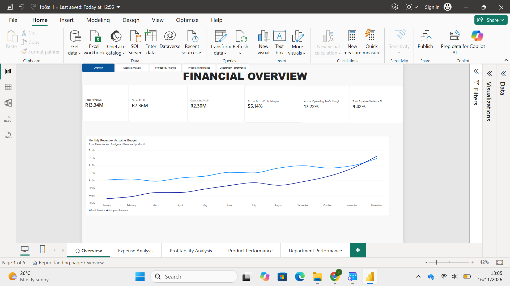
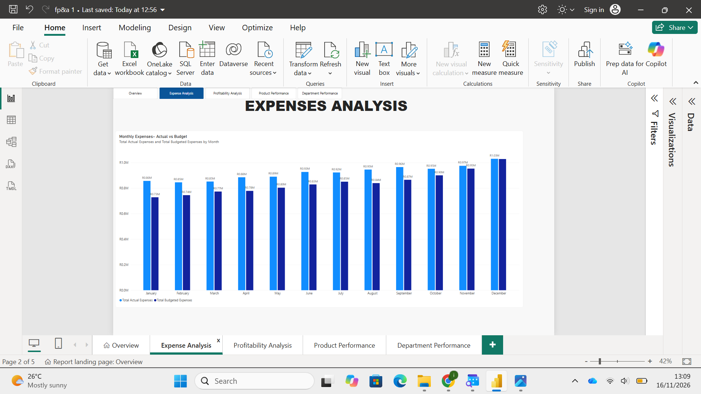
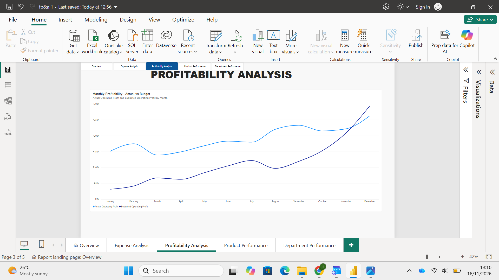
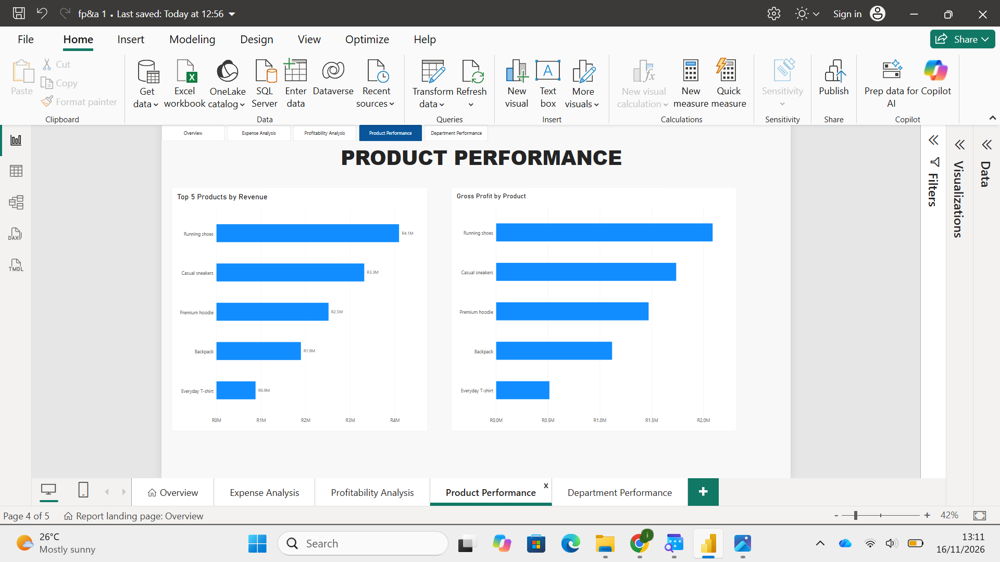
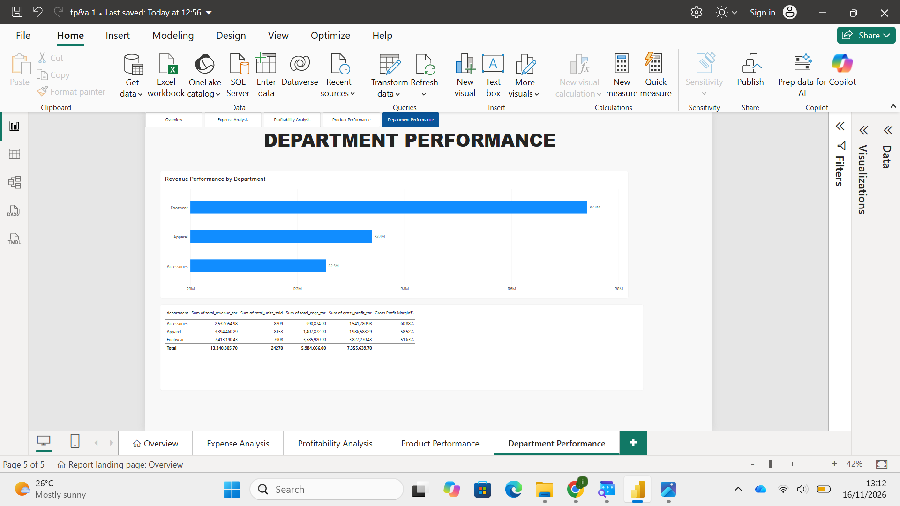

# Retail Financial Performance & Budget Analysis — FY2025

**Author: Inam Cumbi**  
**Tools: PostgreSQL, pgAdmin, Power BI, Power Query and DAX**  
**Period: January–December 2025 | Currency: South African rand (ZAR)**

## Project overview

This portfolio project analyses the financial performance of a fictional South African retailer. It combines SQL data validation and financial analysis with a five-page Power BI report to compare actual performance against budget and evaluate revenue, costs, profitability, products and departments.

The project demonstrates how accounting knowledge and data analytics can support management reporting and commercial decisions. The data is synthetic and does not represent a real business.

## Business questions

- Did revenue and operating profit meet the annual and monthly budgets?
- Where did actual costs exceed planned spending?
- Which products and departments contributed the most revenue and gross profit?
- How do departmental margins differ, and what should management investigate?

## Data

The PostgreSQL database, `financial_performance`, contains four core datasets:

| Dataset | Records | Purpose |
|---|---:|---|
| products | 6 | Product details and department classifications |
| sales_transactions | 12,450 | Sales dates, units, revenue and cost of goods sold |
| expense_transactions | 643 | Operating expense transactions |
| monthly_budget | 204 | Monthly budget amounts by metric and department/category |

Sales transactions run from 1 January to 28 December 2025 and cover all twelve months.

## Methodology

1. Created the PostgreSQL database and imported the CSV datasets using pgAdmin.
2. Validated record counts, date coverage, missing values and invalid financial values. The checks performed returned no missing or invalid financial values.
3. Used SQL aggregation and joins to analyse financial totals, monthly results, products and departments.
4. Loaded the data into Power BI, prepared queries in Power Query, and created a date table and model relationships.
5. Built DAX calculations for revenue, COGS, gross profit, operating expenses, operating profit, margins and budget variances.
6. Reconciled headline Power BI results to SQL outputs and reviewed department margins against departmental revenue and gross profit.

## KPI definitions

| Metric | Calculation |
|---|---|
| Gross profit | Revenue − COGS |
| Gross profit margin | Gross profit ÷ Revenue |
| Total expenses | COGS + Operating expenses |
| Operating profit | Revenue − COGS − Operating expenses |
| Operating profit margin | Operating profit ÷ Revenue |
| Budget variance | Actual − Budget |
| Budget variance % | (Actual − Budget) ÷ Budget |

A positive revenue or profit variance is favourable. A positive expense variance is unfavourable against the static budget, although higher sales volumes can explain part of the additional cost. Overall margins use total profit divided by total revenue; departmental percentages should not be added or averaged to obtain the overall margin.

## Financial results

| KPI | FY2025 actual |
|---|---:|
| Revenue | R13,340,305.70 |
| COGS | R5,984,666.00 |
| Gross profit | R7,355,639.70 |
| Gross profit margin | 55.14% |
| Operating expenses | R5,058,648.35 |
| Total expenses | R11,043,314.35 |
| Operating profit | R2,296,991.35 |
| Operating profit margin | 17.22% |

### Budget performance

Amounts shown below are rounded to match the reported dashboard results.

| Metric | Actual | Budget | Actual − Budget | Variance % | Assessment |
|---|---:|---:|---:|---:|---|
| Revenue | R13.34M | R11.48M | +R1.86M | +16.21% | Favourable |
| COGS | R5.98M | R5.08M | +R906.26K | +17.85% | Unfavourable |
| Operating expenses | R5.06M | R5.01M | +R44.70K | +0.89% | Unfavourable |
| Total expenses | R11.04M | R10.09M | +R950.96K | +9.42% | Unfavourable |
| Gross profit | R7.36M | R6.40M | +R954.83K | +14.92% | Favourable |
| Operating profit | R2.30M | R1.39M | +R910.14K | +65.63% | Favourable |

## Dashboard pages and findings

### 1. Financial Overview

Headline cards show revenue, gross profit, operating profit, gross margin, operating margin and total expense variance. A monthly line chart compares actual revenue with budget.

Revenue exceeded the annual budget by 16.21%. The monthly chart shows actual revenue above budget from January through November, followed by a December shortfall. December nevertheless recorded the highest actual monthly revenue. These are comparisons within FY2025, not year-on-year growth figures.

### 2. Expense Analysis

A monthly clustered column chart compares total actual expenses with budgeted expenses. Total expenses include both COGS and operating expenses.

Annual expenses exceeded budget by R950.96K (9.42%). Approximately 95% of the cost variance came from COGS. Operating expenses were only 0.89% above budget. Because revenue also exceeded plan, additional COGS should be assessed against actual sales volumes and product mix before concluding that the variance reflects inefficiency.

### 3. Profitability Analysis

A monthly line chart compares actual and budgeted operating profit.

Operating profit exceeded the annual budget by R910.14K (65.63%). Operating margin was 17.22%, compared with a budgeted 12.08%, an improvement of 5.14 percentage points. Gross margin was 55.14%, below the budgeted 55.76% by 0.62 percentage points. Together, these results indicate that operating expenses absorbed a smaller proportion of revenue than planned, offsetting the lower gross margin.

Actual operating profit exceeded budget from January through November but fell short in December. The chart identifies the timing of the shortfall; it does not establish its cause.

### 4. Product Performance

Horizontal bar charts show the top five products by revenue and their gross profit contributions.

Running shoes ranked first in both revenue and gross profit, followed by casual sneakers. Premium hoodies and backpacks also made substantial contributions. The two footwear products together generated R7.41M, approximately 55.57% of total revenue, creating a significant concentration in that product category. Gross profit contribution is distinct from gross margin percentage.

### 5. Department Performance

A revenue bar chart and summary table compare revenue, units sold, COGS, gross profit and gross margin across the three departments.

| Department | Revenue | Units sold | COGS | Gross profit | Gross margin |
|---|---:|---:|---:|---:|---:|
| Accessories | R2,532,654.98 | 8,209 | R990,874.00 | R1,541,780.98 | 60.88% |
| Apparel | R3,394,460.29 | 8,153 | R1,407,872.00 | R1,986,588.29 | 58.52% |
| Footwear | R7,413,190.43 | 7,908 | R3,585,920.00 | R3,827,270.43 | 51.63% |
| **Total** | **R13,340,305.70** | **24,270** | **R5,984,666.00** | **R7,355,639.70** | **55.14%** |

Footwear produced the largest revenue and gross profit contribution despite having the lowest departmental margin. Accessories achieved the highest margin and units sold. This supports evaluating both contribution and margin when making product and department decisions. Departmental gross profit does not include an allocation of operating expenses and therefore does not establish departmental operating profitability.

## Management recommendations

1. **Investigate December's revenue and operating profit shortfalls.** Compare actual and budgeted units, selling prices, discounts and product mix. Review the assumptions behind the sharp increase in December's budget before changing future targets.
2. **Assess COGS using a flexible budget.** Recalculate expected costs for actual sales volumes and mix, then investigate purchasing costs and realised unit margins. The static-budget variance alone cannot isolate price, volume or mix effects.
3. **Protect availability of key footwear products.** Use their revenue and gross profit contribution to prioritise demand and stock planning, while monitoring inventory turnover and cash requirements before increasing purchases.
4. **Test opportunities in higher-margin categories.** Evaluate accessory bundles and apparel cross-selling using incremental gross profit, demand and stock requirements. Higher margin percentages alone do not guarantee higher total profit.
5. **Maintain operating expense discipline.** Monitor monthly spending and investigate material exceptions as sales expand, using the annual 0.89% overrun as a starting point for category-level review.

## Skills demonstrated

- SQL joins, aggregations, financial calculations and data validation.
- Power Query preparation and Power BI data modelling.
- DAX measures, calculated columns and financial KPI design.
- Static budget versus actual analysis and variance interpretation.
- Product and department contribution analysis.
- Management reporting and evidence-based recommendations.

## Scope and limitations

- This is a historical financial performance and static-budget analysis project. It does not include a completed rolling forecast, cash-flow forecast, scenario model or integrated three-statement model.
- The synthetic data supports a portfolio demonstration, not conclusions about a real retailer.
- One year of data cannot establish recurring seasonality or year-on-year growth.
- The dashboard identifies variances and patterns; causes such as demand, supplier inflation or stock shortages require additional evidence.
- Budget comparisons and margins displayed in the report are rounded.

## SQL reconstruction and validation status

The original SQL history was unavailable. The included SQL scripts were reconstructed from the supplied table structure and project requirements. The user supplied PostgreSQL execution results for the financial totals and monthly comparison. All 72 monthly rows reconcile to an independent calculation from the original CSV files. See `validation/VALIDATION.md` for evidence and remaining validation limits. The original four CSV datasets are included in `data/`.

## Reproducing the analysis

The workflow requires PostgreSQL, pgAdmin, Power BI Desktop, the four CSV datasets, SQL scripts and the completed Power BI report.

1. Create the `financial_performance` database and run `schema.sql`.
2. In pgAdmin, import the four files from `data/` into their matching tables using CSV format, Header enabled, comma delimiter and UTF-8 encoding. Follow the column order in each CSV header.
3. Run the validation and financial analysis queries in `analysis_queries.sql`.
4. Open the Power BI report and update its PostgreSQL connection to the local server and database. Use local credentials rather than publishing credentials in project files.
5. Refresh the report and reconcile the headline results to the KPI table above.

## Repository Structure

The package includes the original datasets, reconstructed SQL scripts, supplied Power BI report, five screenshots and validation evidence.

| Location | Contents |
|---|---|
| README.md | Project documentation |
| data/ | Four synthetic CSV datasets |
| sql/schema.sql | Database table definitions |
| sql/analysis_queries.sql | Validation and financial analysis queries |
| powerbi/ | Completed Power BI report file |
| screenshots/ | Images of the five dashboard pages |
| validation/ | Monthly SQL output and reconciliation notes |

The screenshots folder contains the five supplied dashboard captures, including the corrected departmental margins. The captures include the Power BI Desktop interface. Some department table headings retain their source-field names.
